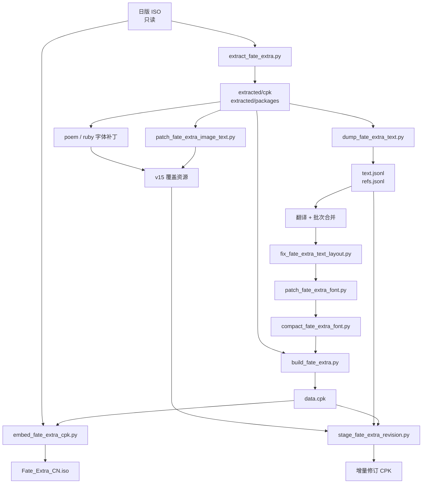

# 端到端流水线

本文件给出从原盘到可玩 ISO 的完整阶段划分、每步的输入输出与命令。所有命令默认在工程根目录执行（脚本内的相对路径都以 `work/` 为基准）。

> 只想重建或改稿，看 [11-quick-rebuild.md](11-quick-rebuild.md)。本篇是**流水线本身的说明**，
> 用于改动其中某个阶段（补字规则、图片重排、打包逻辑）时对照。

## 1. 阶段总表

| # | 阶段 | 主要脚本 | 输入 | 输出 | 验证点 |
|---|---|---|---|---|---|
| S0 | 源准备 | 系统挂载 | 日版 ISO | 只读挂载点 | 镜像号 `NPJH-50247` |
| S1 | CPK 解包 | `extract_fate_extra.py` | `data.cpk` | `extracted/cpk`、`extracted/packages`、`manifest.json` | 5,824 条目 / 2,297 处理 / 2,240 包 |
| S2 | 文本转储 | `dump_fate_extra_text.py` | `packages`、`cpk/day` | `text.jsonl`、`refs.jsonl` | 19,711 唯一 ID |
| S3 | 翻译 | 人工/代理 + `apply_translation_batches.py` | `text.jsonl`、批次 | 合并后的 `text.jsonl` | 非空译文 19,709 |
| S4 | 排版 | `fix_fate_extra_text_layout.py` | `text.jsonl`、`refs.jsonl` | 带安全换行的 `text.jsonl` | 对话 ≤ 24 全角字/行 |
| S5 | 正文补字 | `patch_fate_extra_font.py` | `text.jsonl`、`kanzi.bin`、`font.txb` | `glyph-map.json`、新字库 | 1,571 别名 |
| S6 | 字库压缩 | `compact_fate_extra_font.py` | 扩展字库、文本 | 4,096 字 / 16 页 | 运行时索引上限 |
| S7 | 重建 CPK | `build_fate_extra.py` | 文本、引用、字库 | `data.cpk` | 指针重定向、PAK/CMP 回环 |
| S8 | 写回 ISO | `embed_fate_extra_cpk.py` | 原 ISO、新 CPK | 新 ISO | ISO9660 目录/卷大小 |
| S9 | 增量修订 | `stage_fate_extra_revision.py` | 旧 CPK、新旧文本 | `text-overlay/`、`assets/`、`build-report.json` | 每条替换对旧字节 |
| S10 | 图片本地化 | `fate_extra_texture.py` + `patch_fate_extra_image_text.py` | UI TXB、配置 JSON | 覆盖 TXB | 2,598 TEX 变更 |
| S11 | 诗文/ruby 字库 | `patch_fate_extra_poem_font.py`、`patch_fate_extra_annotation_fonts.py` | 字库、映射 | 新字库 | 518 字 / 3 页 |

## 2. 流程图



## 3. 各阶段命令

### S1 CPK 解包

```sh
# 列出 CPK 内容
python3 scripts/pipeline/extract_fate_extra.py list \
  /path/to/PSP_GAME/USRDIR/data.cpk > work/cpk-list.json

# 解包 DAT / PAK / CMP，并解开每个包
python3 scripts/pipeline/extract_fate_extra.py extract \
  /path/to/PSP_GAME/USRDIR/data.cpk --output work/extracted
```

产物：

- `work/extracted/cpk/`：CPK 内原始条目（DAT/PAK/CMP）。
- `work/extracted/packages/`：解包后的成员文件，保持游戏内路径。
- `work/extracted/manifest.json`：CPK 头、条目表、每个包的条目清单。

### S2 文本转储

```sh
python3 scripts/pipeline/dump_fate_extra_text.py work/extracted/packages \
  --day-input work/extracted/cpk/day \
  --output work/translation/text.jsonl \
  --references work/translation/refs.jsonl
```

转储器扫描 DAT 字节码中的文本指针操作码（`0x3926` 对话、`0x1530` 回想），并单独处理 57 个 `day/*.dat` 章节脚本。`id` 由源字符串字节的 SHA-256 前 16 位生成，因此同一句台词在多个文件中复用时只占一行。

`refs.jsonl` 每行至少包含：

```json
{"id":"...", "file":"000016/field/016/0000.dat", "text_offset":69080,
 "pointer_offsets":[69076], "kinds":["dialogue"]}
```

### S3 翻译与合并

翻译以约 100 条为一个批次，共 211 个批次。批次只写 `{id, zh_cn}`，再由脚本合并回主表：

```sh
python3 scripts/pipeline/apply_translation_batches.py \
  --source work/translation/text.jsonl \
  --batches work/translation/batches
```

术语统一见 `data/glossary-GLOSSARY.md`。合并脚本默认不覆盖已有译文，必须显式 `--overwrite` 才能替换。

### S4 排版

```sh
python3 scripts/pipeline/fix_fate_extra_text_layout.py \
  --translations work/translation/text.jsonl \
  --references work/translation/refs.jsonl \
  --max-width 24
```

只对 `dialogue / backlog / dungeon_dialogue / popup` 类文本插入换行；`0x0126` 动画章节卡文本**不插换行**，否则会改变动画布局。标点不出现在行首，控制码不参与宽度计算。

### S5 正文补字

```sh
python3 scripts/pipeline/patch_fate_extra_font.py \
  --translations work/translation/text.jsonl \
  --refs work/translation/refs.jsonl \
  --extract-root work/extracted/packages \
  --out-root work/build/assets/packages/pack/PRELOAD \
  --glyph-map work/translation/glyph-map.json \
  --allocations work/translation/glyph-allocations.jsonl \
  --renderer scripts/pipeline/render_font_glyphs.swift
```

分配规则：能不新增就不新增；必须新增时使用 CP932 用户区（`0xE000` 起），绝不占用仍有日文引用的原有字位。

### S6 字库压缩

```sh
python3 scripts/pipeline/compact_fate_extra_font.py \
  --build-root work/build \
  --extract-root work/extracted \
  --translations work/translation/text.jsonl \
  --glyph-map work/translation/glyph-map.json \
  --max-glyphs 4096
```

从 4,611 字压回 4,096 字，删除 515 个已无引用的日文字形，保留全部中文与仍在使用的日文。

### S7 重建 CPK

```sh
python3 scripts/pipeline/build_fate_extra.py \
  --translations work/translation/text.jsonl \
  --references work/translation/refs.jsonl \
  --glyph-map work/translation/glyph-map.json \
  --extract-root work/extracted \
  --manifest work/extracted/manifest.json \
  --source-cpk /path/to/data.cpk \
  --output-cpk work/build/data.cpk
```

关键行为：

- 新串不长于原串：原地覆盖，并把原槽剩余字节全部清零（部分渲染器按存储字符数读取，不清零会露出旧字）。
- 新串更长：追加到 DAT 末尾，回填所有 `pointer_offsets`。
- DAT 末尾 16 字节对齐。
- 受影响的 PAK/CMP 重新打包；CMP 用 IECP LZSS 重压。
- CPK 按 2,048 字节对齐重排，更新 TOC 的 `FileOffset/FileSize/ExtractSize` 与 ETOC。

### S8 写回 ISO

```sh
python3 scripts/pipeline/embed_fate_extra_cpk.py \
  --source-iso /path/to/original.iso \
  --cpk work/build/data.cpk \
  --output-iso work/build/Fate_Extra_CN.iso \
  --allow-volume-growth
```

`data.cpk` 变大会占用后续扇区，必须同时更新 ISO9660 目录记录的 extent size 与 PVD 卷大小。若 CPK 文件名大小写被改写，还要用 `patch_fate_extra_iso_case.py` 恢复小写 `data.cpk`（游戏按小写查找）。

### S9 增量修订（v15 路线）

全量重建代价高，且容易把旧解包状态带回。v15 使用"对旧 CPK 做定点替换"：

```sh
python3 scripts/pipeline/stage_fate_extra_revision.py \
  --source-cpk work/build/Fate_Extra_CN-v14.iso的data.cpk \
  --previous-translations work/translation/text.pre-v15.jsonl \
  --translations work/translation/text.jsonl \
  --previous-glyph-map work/translation/glyph-map.v14.json \
  --glyph-map work/translation/glyph-map.json \
  --poem-glyph-map work/translation/poem-glyph-map.json \
  --references work/translation/refs.jsonl \
  --overlay work/build/localization-v15/assets/packages \
  --out work/build/localization-v15 \
  --prepare-only
```

`--prepare-only` 只生成覆盖层与报告，不产出 CPK。报告字段：

| 字段 | v15 值 |
|---|---:|
| `changed_ids` | 1,186 |
| `changed_dat_files` | 743 |
| `applied_references` | 15,674 |
| `overlay_resources` | 375 |
| `cpk_paths` | 871 |
| `prepared_only` | true |

去掉 `--prepare-only` 才会真正重写 CPK。

### S10 图片本地化

```sh
# 启动虚构声明
python3 scripts/pipeline/patch_fate_extra_image_text.py \
  data/evidence/ui/image-text-patches.json \
  --source work/extracted/packages/pack \
  --out work/build/localization-v15/assets/packages/pack \
  --previews work/research/ui-localization-audit/translated

# 274 个小图 + 260 份重复包分发
python3 scripts/pipeline/patch_fate_extra_image_text.py \
  data/evidence/ui/ui-text-patches.json \
  --previews work/research/ui-localization-audit/translated-ui

# 191 页教程
python3 scripts/pipeline/patch_fate_extra_image_text.py \
  data/evidence/ui/tutorial-text-patches.json \
  --previews work/research/ui-localization-audit/translated-tutorials
```

### S11 诗文与 ruby 字库

```sh
# 诗文：14×14 格，324 字/页
python3 scripts/pipeline/patch_fate_extra_poem_font.py \
  --translations work/translation/text.jsonl \
  --references work/translation/refs.jsonl \
  --glyph-map work/translation/glyph-map.json \
  --extract-root work/extracted/packages/pack \
  --build-root work/build/poem-v14-native-grid \
  --renderer scripts/pipeline/render_font_glyphs.swift

# ruby：9×9 槽，196 字/页，保留原 219 字
python3 scripts/pipeline/patch_fate_extra_annotation_fonts.py \
  --source work/build/poem-v14-native-grid/assets/packages/pack/PRELOAD \
  --translations work/translation/text.jsonl \
  --glyph-map work/translation/glyph-map.json \
  --out work/build/localization-v15/assets/packages/pack/PRELOAD \
  --out-glyph-map work/translation/glyph-map.v15.json \
  --report work/translation/review-20261019/annotation-font-build.json \
  --renderer scripts/pipeline/render_font_glyphs.swift
```

## 4. 阶段间的硬约束

1. **S2 的 `id` 必须稳定**。改转储逻辑会改变 ID，进而使所有批次失效。需要改提取规则时，先做 ID 兼容性对照。
2. **S4 必须在 S5 之前**。换行会影响字符集合与字库需求；反过来做会漏字。
3. **S5 的 `glyph-map.json` 一旦分配就不能重排**。已有译文用旧别名编码，重排会让旧文本指向错误字形。
4. **S7 的 `refs.jsonl` 必须与 `text.jsonl` 同源**。用旧引用配新文本会把译文写到错误偏移。
5. **S9 必须验证旧字节**。每个待替换位置先按旧译文编码，与 CPK 中的实际字节比对；不一致立即中止，防止把错位文本写进去。
6. **S10 只输出声明过的文件**。未在配置中列出的 TXB 不写，避免"复制整包"导致其他场景被旧版本覆盖。

## 5. 最小可运行闭环

如果只想验证工具链，不需要完整翻译：

1. 解包 → 转储 → 只翻译 100 条；
2. 生成 `glyph-map.json`（哪怕为空）；
3. 重建 CPK → 写回 ISO；
4. 在 PPSSPP 进入开场，确认这 100 条显示为中文且不崩。

这条闭环能在不触碰字库/图片的情况下验证 S1–S8 的正确性，适合修改底层格式代码后的回归。
