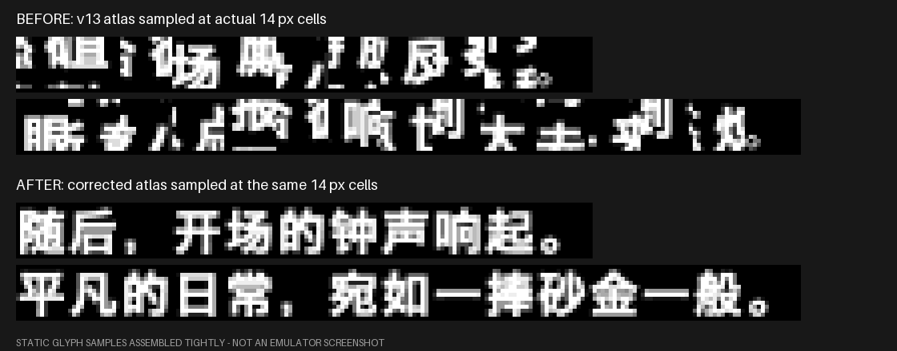
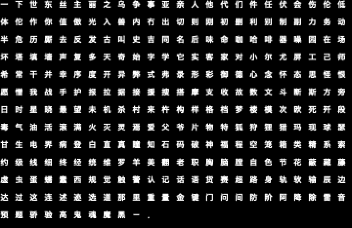

# 诗文格与 ruby 小字：两套独立的字库

这两个模块是工程里最容易"看起来该一样，其实完全不一样"的部分。它们都叫"字库"，但格尺寸、每页字数、坐标公式、控件码全部不同。用正文字库的假设去处理它们，会得到碎字、错字或整段不显示。





---

## 一、诗文（poem）字库

### 1. 现象

章节标题卡上的中文诗句显示为**相邻字的碎片**：每个位置只露出某个字的局部，拼起来不是任何可读文本。截图中的两行分别对应：

- 随后，开场的钟声响起。
- 平凡的日常，宛如一捧砂金一般。

### 2. 根因

生产脚本按正文字库的 **16×16 格、16 列、256 字/页** 重建了诗文图集；游戏运行时却按 **14×14 格、18 列 × 18 行、324 字/页** 采样。

于是索引 350 的字：

| 假设 | 页 | u | v |
|---|---:|---:|---:|
| 错误（16px） | 1 | 224 | 80 |
| 正确（14px） | 1 | 112 | 14 |

游戏取到的是另一块纹理，自然只看到邻字的笔画。

### 3. 证据

来自解密后的 `EBOOT.dec`（SHA-256 `e6eb5f54…7864f236`）静态反汇编：

- `0xA6254–0xA6260`：对 CPoem 对象 `+0x48` 调用 `0xACD0C`，`a1=a2=0xE`（14）；
- `0xACD0C` 只做 `obj[0]=a1; obj[4]=a2`，确认这是格宽/格高；
- `0xB553C`：`columns = textureWidth / cellWidth`；
- `0xB62C0`：`page = index / perPage`；
- `0xB6370`、`0xB641C`：`within = index % perPage`，`u=(within%columns)*cellWidth`、`v=(within/columns)*cellHeight`；
- `0xB64E0–0xB6534`：UV 右/下端点为 `u+cellWidth-1`、`v+cellHeight-1`。

原版配置因此是：

```
cell = 14×14
columns = rows = 256 // 14 = 18
perPage = 324
page    = index // 324
u       = (index % 324 % 18) * 14
v       = (index % 324 // 18) * 14
```

### 4. 独立复现

`data/evidence/poem/reproduce.py` 不依赖旧构建目录，只用保留的小快照：

1. 读取实际 `0000.dat`，解析偏移 9840、9904 的指针；
2. 通过实际 `poem.bin` 解析编码键；
3. 用实际 `poem_font.txb` 按 14px 网格采样。

得到的错误碎片与用户截图逐像素比对：

| 行 | 归一化灰度相关 | 截图位置 |
|---|---:|---|
| 第一行 | 0.96088 | X=492, Y=590, 265×26 |
| 第二行 | 0.96510 | X=492, Y=624, 360×26 |

共同缩放约 1.84；截图游戏画面宽 879 / 原生 480 = 1.83125，吻合。这证明是**同一处网格错误**，不是"字体本身难看"。

修复后用同一 14px 网格、同一 DAT 字节采样，两行均为完整可读中文；`final-atlas-check.json` 记录 396 个字形、0 空字、0 映射错位、最后一行/列无非零像素。

### 5. 修复要点

- 字格 14×14，实际墨迹 13×13，最后一列/行透明（避免双线性采样到邻格）；
- 256×256 页，18×18 = 324 字/页；
- `poem.bin` 记录数 + 每条 6 字节；索引顺序 = 行号顺序；
- `poem_font.txb` 是普通 TXB（无路径名），但页数与尺寸必须与 `poem.bin` 一致；
- 章节卡文本走 `0x0126` motion，**不能插换行**；其别名映射也要用诗文专用表，不能直接用正文字库的 `glyph-map`。

### 6. 影响面

`poem.pak` 在 CPK 中有 12 份副本（不同章节包各带一份）。修复时必须**全部替换**，否则只有部分章节正常。`data/evidence/poem/audit.json` 记录了 12 份副本的成员哈希。

---

## 二、ruby（双层表记）小字

### 1. 什么是 ruby

日文用 `#RUBS小字#RUBE正文#REND` 表示上下两层：

```
#RUBSしんじ#RUBE慎二#REND        ← 读音 / 汉字
#RUBSマスター#RUBE奏者#REND      ← 外来语 / 意译
#RUBSありす#RUBEあたし#REND      ← 名字 / 第一人称
```

中文不能照搬日文读音，但也不能把所有双层都删掉——Fate/Extra 大量用双层表达"同一存在的两种称呼"。

### 2. 两类问题

审计发现两个**互相独立**的缺陷：

| 问题 | 表现 | 根因 |
|---|---|---|
| 文本层 | 双层被删、重复译成同一词、`#REND` 缺失、颜色范围错 | 翻译时把 ruby 当普通文本处理 |
| 资源层 | 即使保留控件码，小字仍不显示/缺字 | `ruby.bin`/`ruby.txb` 是原版，219 字全是假名+Latin，**0 汉字** |

只修文本不补字库，或只补字库不修文本，都不能解决问题。

### 3. 文本审计

范围：全部 19,711 条，其中日文含 ruby 的 1,830 条、2,119 组；直接阅读全部 929 种上下层组合，逐类决定保留/取消。

| 指标 | 修正前 | 修正后 |
|---|---:|---:|
| 含 `#RUBS` 的中文条目 | 1,651 | 1,259 |
| 完整 ruby 结构 | 1,649 | 1,259 |
| 完整 ruby 组 | 1,878 | 1,402 |
| 上下层完全同文 | 337 | **0** |
| 结构缺损 | 2 | **0** |
| 与原文语义组数不符 | — | **0** |

最终保留：

- 1,368 组"特殊双意表记"；
- 34 组强调点（`・・・・`）；
- 取消 717 组普通日文读音（中文不需要在正文上再标一遍假名）。

### 4. 语义规则（节选）

| 原文 | 决定 | 理由 |
|---|---|---|
| `つくみはら / 月海原`、`しんじ / 慎二` | 取消读音层，正文直接写中文 | 普通人名/地名读音 |
| `マスター / 奏者` | 保留"御主 / 奏者" | 系统称谓与亲昵称谓不同 |
| `ウィザード / 魔術師` | 保留"Wizard / 魔术师" | 灵子黑客 vs 旧式魔术师 |
| `トリガー / 暗号鍵` | 保留"触发器 / 暗号键" | 系统名与叙事名并存 |
| `ドール / 人形` | 改为"Doll / 人偶" | 避免"人偶/人形"近义词重复 |
| `ありす / あたし` | 保留"爱丽丝 / 我" | 姓名与人称的身份叠写 |
| `な / 命`、`な / 冠` | 按尼禄语境恢复 | 名字与"生命/冠冕"的双关 |
| `・・・・ / 强调内容` | 保留强调点，按中文长度重点 | 不是重复汉字 |

不是所有片假名都保留：`カ/呵`（笑声）、`コトミネ/言峰`、`エイト/Ⅷ` 等普通读音在中文中取消。

### 5. 修出的具体错误类型

- **结构**：`1b975b01efbb4f0a` 缺 `#REND`，强调范围只剩半句；
- **顺序**：`6b05329273de8c33` 日文先"痴"后"御主"，中文顺序相反，机械删层会误删"御主"；
- **语义反写**：`282a8bb9021ab088` 把"本能拒绝前进"译成"声音令我继续前进"；
- **残词**：取消普通注音后留下"会喋""这就是宿""轻轻地头"等，逐句修为"会说话""这就是宿命""轻轻地摇了摇头"。

完整 1,133 条修正见 `data/review/ruby-fixes.jsonl`；逐组决定见 `ruby-pair-decisions.jsonl`（未入库，可由脚本重建）。

### 6. 字库审计

原资源：

| 资源 | 大小 | 内容 |
|---|---:|---|
| `ruby.bin` | 1,328 | 219 条，全假名/全角 Latin/符号，汉字 0 |
| `ruby.txb` | 17,296 | 2 页，128px 宽，9×9 槽，196 字/页 |

格式：

```
ruby.bin: uint32 count + count×6 字节 + 16 字节对齐
ruby.txb: PAK(count=2, flags=0x8000)
          font08_00.tex 128×128 T4
          font08_01.tex 128×130（存储 128×136）T4
```

坐标：

```
page   = index // 196
tile   = index % 196
x      = (tile % 14) * 9
y      = (tile // 14) * 9
```

关键细节：

- 原字并非都在 8×8 内：`ｇｊｐｑｙ` 占第 9 行，`ばふむもりオネ` 占第 9 列，**不能裁成 8×8**；
- 第二页逻辑高 130、T4 存储高 136，必须按 `data_size` 解 swizzle；
- `ruby.txb` 带 64 字节文件名，`write_font_txb(..., has_paths=True)` 不写名字，不能直接用；
- 每页 196 槽，两页 392，原用 219，余 173。

### 7. 扩容方案

修正后统计：

| 指标 | 值 |
|---|---:|
| 上标不同字符 | 349 |
| 原表缺失字符 | 299（297 汉字 + `．` + `－`） |
| 缺失字次 | 2,541 |
| 最终字表 | 219 + 299 = **518** |
| 页数 | **3**（196/页） |

实现：

1. 新字沿用正文 `glyph-map.json` 的别名，**不为 ruby 再分配一套 PUA**；
2. `ruby.bin` 追加 6 字节记录，更新 count，补 16 字节对齐；
3. 9×9 槽渲染，汉字主体控制在 8px 内，保留第 9 行/列；
4. 先填第二页剩余 173 槽，再新增第三页；
5. 生成 128px 宽、pitch 9、196 槽/页的 T4 图集，保留原调色板与元数据；
6. 页数是否有运行时上限未由 EBOOT 证实，需实机确认。

### 8. 验证状态

- 文本层：结构、组数、语义已静态核对，0 缺损、0 组数不符；
- 资源层：518 条 / 3 页已生成，原 219 字保留，已有别名未移动；
- 运行时：**未完成**实机逐句确认。缺字时的具体回退行为（空白/替代框）也未被静态证明。

---

## 三、两套字库的对照

| 项目 | 正文 | 诗文 | ruby |
|---|---|---|---|
| 文件 | `kanzi.bin` + `font.txb` | `poem.bin` + `poem_font.txb` | `ruby.bin` + `ruby.txb` |
| 格尺寸 | 16×16 | 14×14 | 9×9 |
| 每页字数 | 256 | 324 | 196 |
| 纹理宽 | 256 | 256 | 128 |
| 页数 | 16 | 2 | 3 |
| 运行时上限 | 4,096 | 未确认 | 未确认 |
| 编码来源 | 原生 CP932 + PUA 别名 | 同正文（独立映射表） | 同正文（共用别名） |
| 控件码 | 普通文本 | `0x0126` motion | `#RUBS/#RUBE/#REND` |

**不要把任意一列的假设套到另一列**。这是本项目最昂贵的一课。
