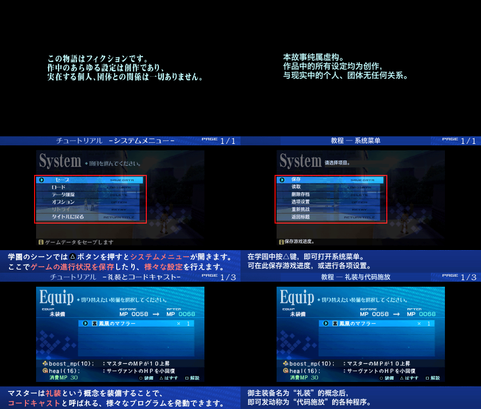

# UI 图片本地化

游戏里大量文字不是文本表，而是**烘焙进纹理的像素**：难度说明、保存/读取、装备栏、教程页、开战动画大字、启动虚构声明。文本表译得再全，这些地方仍然是日文。



本模块的目标：在不破坏原图风格、按钮、边框和调色板的前提下，把声明的文字矩形替换为中文。

---

## 1. 先盘点，再动手

原始资源里 `/interface/` 下的 TXB 共 **2,113 个**。按文件内容 SHA-256 去重后，实际不同的界面包只有 **200 个**；其余是同一资源在不同章节包中的副本。

去重后的统计：

| 指标 | 数量 |
|---|---:|
| 唯一界面 TXB | 200 |
| 非空 TEX | 1,627 |
| 空 TEX 条目 | 330 |
| 最终输出 TXB | 371（含别名分发） |
| 实际变更 TEX | 2,598 |
| 变更资源总字节 | 71,320,704 |
| 规范编辑目标 | 466 |
| 按哈希复制的别名包 | 260 |

注意"371 > 200"：输出包含为保持各场景一致而复制的别名包。只改一份，其他场景仍会显示日文。

---

## 2. 定位文字：OCR + 人工确认

### 2.1 解码

`fate_extra_texture.py` 把 TXB 内的 TEX 解码为 RGBA：

- 支持 T4 / T8；
- PSP 16 字节 × 8 行 swizzle；
- 32×32 CCT 与 RGBA8888；
- 保留 TXB 路径、空条目、尾字节、TEX 尺寸与调色板。

硬性校验：**未修改的索引图解码后再编码，必须逐字节相同**。不满足就不能进入编辑流程。

### 2.2 OCR

`scripts/audit/ocr.swift` 使用 macOS Vision（`ja-JP`、`en-US`）批量识别解码后的 PNG，输出文字与 bbox。OCR 只用来**找候选区域**，不直接当译文：

- 小字、描边字、彩色字经常识别错；
- 图标、数字、英文装饰会被误报；
- 必须结合 PNG 人工确认矩形。

### 2.3 任务包

每个待译图片生成一条任务：

```json
{
  "image_id": "...",
  "kind": "tutorial | fiction | advice | ui",
  "image": "path/to.png",
  "body_ocr": [{"text": "...", "bbox": [x, y, w, h]}],
  "notes": "..."
}
```

分两批（A/B）交给两个翻译代理逐图阅读，输出：

```json
{"image_id":"...", "title_zh":"...", "body_zh":["第一行","第二行"]}
```

约束：

- 教程正文最多 2 行，每行约 ≤ 30 个全角字（480px 图、14px 字号）；
- 保留 `△□○×` 按钮符号；
- 命令/英文专名可保留英文；
- 截图中间的原 UI 标签只作上下文，**不要混进说明文字**；
- OCR 不确定时在 `notes` 说明，不编造机制或数字。

---

## 3. 配置驱动替换

`patch_fate_extra_image_text.py` 只认 JSON 配置，不猜：

```json
{
  "entries": [
    {
      "file": "modeselect/interface/modeselect/fiction.txb",
      "index": 0,
      "blocks": [
        {"rect": [40, 60, 400, 24], "text": "本作品为虚构……",
         "size": 14, "color": [255,255,255], "align": "center"}
      ]
    }
  ]
}
```

字段：

| 字段 | 说明 |
|---|---|
| `file` | 相对 `pack/` 的 TXB 路径 |
| `index` | TEX 在 TXB 中的序号 |
| `rect` | `[x, y, w, h]`，声明可写区域 |
| `text` | 中文文本，可含 `\n` |
| `size` | 字号（像素） |
| `color` | RGB；新字会量化回原调色板 |
| `align` | `left/center/right` |

执行流程：

1. 解析 TXB，保持条目顺序与名字；
2. 对每个 TEX 先做"未修改回环"校验；
3. 在 `rect` 内擦除原文字像素（只擦声明的矩形，不碰按钮/边框/图标）；
4. 用 Hiragino Sans GB W6 渲染中文；
5. 量化到原 16 色调色板；
6. 重新编码 T4/T8 + swizzle；
7. 写回 TXB，更新 `data_size`、CCT 非空计数、唯一块数；
8. 输出预览 PNG。

渲染器会**拒绝超出声明矩形的文本**，避免悄悄裁字。

---

## 4. 三类重点资源

### 4.1 启动虚构声明

位置不是 logo 商标包，而是：

```
pack/modeselect/interface/modeselect/fiction.txb
```

480×272，T8 + CCT32，一整页图片。配置见 `data/evidence/ui/image-text-patches.json`。

### 4.2 注意页

```
pack/advice/interface/advice/0000.txb
```

提示"存在死路与不合理选项，建议多存档"，文字按行切分在图片中。

### 4.3 教程

`tutorial_other_00` … `tutorial_other_71`，共 191 页；解码 RGBA 去重后 168 张。

- 标题与底部说明是烘焙文字 → 已翻译；
- 中间截图是**原游戏画面**，不属于当前运行时 UI 资源 → 保留原样；
- 首教程 `00/01` 的明确操作标签（如"系统菜单""保存"）单独替换；
- 高亮宝具名、投影准备、灵魂篡改操作区等，列入 `screenshot_terms` 供后续按矩形补。

这一区分很重要：**教程标题/规则正文已译全，不等于截图内部每个 UI 字都已译**。

### 4.4 小图

274 个独立小图/片段，覆盖：

保存、读取、删除、选项、装备、道具、状态、情报矩阵、战斗警告、地图层数、日期、从者选择、宝具咏唱、开战动画大字（決/戰/開/聖/争/勝 → 简体）。

---

## 5. 别名分发

同一 TXB 在不同包中可能有完全相同的字节。按原始整文件 SHA-256 分组：

- 每组只编辑一次；
- 把结果复制到组内所有路径；
- v15 中 466 个规范目标 → 分发到 260 个别名包。

不这么做的典型症状：在序章改了保存界面，进第二章又变回日文。

另外**不输出** `modeselect/modeselect.txb`：该文件的难度选择页在 v14 已有翻译，重复输出会用旧版本覆盖新资源。

---

## 6. 验证

`data/evidence/ui/final-validation.json` 记录：

| 检查 | 结果 |
|---|---|
| 200 个去重原 TXB、1,627 非空 TEX、330 空条目 | 解码→重编码逐字节相同 |
| 371 个输出 TXB | 再解析/重编码逐字节相同 |
| 条目名与顺序、尺寸、调色板 | 逐项相同 |
| 274 小图 + 191 教程页 | 索引图与预期像素一致 |
| 文本溢出 | 渲染器拒绝，0 越界 |
| 视觉抽检 | 启动声明、首教程、混合字图、边框图已查看 |

对比图：`data/evidence/ui/before-after-proof.png`。

---

## 7. 未完成/保留项

`remaining-ui-candidates.json` 保存所有 OCR 命中但本批未处理的条目：

- 制作名单/人名：保留原文；
- poem 字库与背景：由诗文流程负责；
- 性别图标、相同汉字、数字、英文装饰：多为 OCR 误报；
- 单字"仮"临时图标：用途待确认；
- 教程截图内部的 UI 标签：需按精确矩形继续补。

本模块的准确表述是：**`/interface/` 范围内声明的 466 个编辑目标已完成并验证**，不是"游戏所有日文图片已全译"。模型贴图、场景看板、视频字幕、PSP 系统对话不在本次 1,627 图证明范围内。

---

## 8. 相关文件

- 脚本：`scripts/pipeline/fate_extra_texture.py`、`patch_fate_extra_image_text.py`、`patch_fate_extra_ui.py`
- 配置：`data/evidence/ui/image-text-patches.json`、`ui-text-patches.json`、`tutorial-text-patches.json`
- 报告：`final-validation.json`、`remaining-ui-candidates.json`
- 审计脚本：`scripts/audit/ocr.swift`、`make-ui-config.py`、`make-tutorial-config.py`
